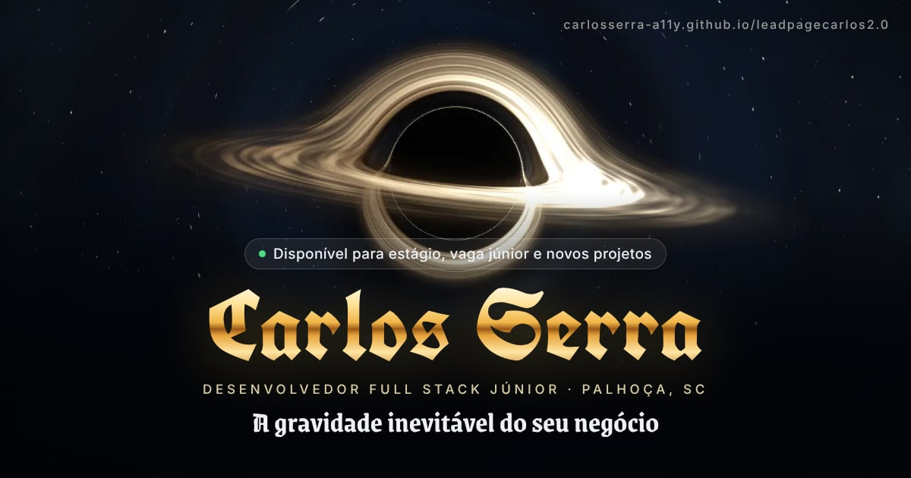

# leadpagecarlos 2.0 · Gótico Cósmico

Landing page de **Carlos Serra**, desenvolvedor full stack júnior em Palhoça/SC.
Tem dois objetivos: **conseguir estágio ou vaga júnior** e **vender a criação de sites**.

**No ar:** https://carlosserra-a11y.github.io/leadpagecarlos2.0/



## O que tem na página

| Seção | O que faz |
|---|---|
| **Intro** | O anel do alfabeto gótico se forma e "Carlos Serra" é escrito letra por letra em traço dourado (os contornos reais da fonte), depois se preenche e recebe um brilho. O contador segue o carregamento real. A página se abre em círculo a partir do buraco negro. Aparece só na primeira visita da sessão e pode ser pulada. |
| **Hero** | Buraco negro calculado com física de verdade: cada pixel segue a trajetória da luz em volta da massa (relatividade geral). Por isso aparecem o arco do disco por cima e por baixo da sombra, o anel de fótons e as estrelas do fundo deformadas pela lente. O disco de gás tem a cor e o brilho da temperatura real, fica mais claro do lado que vem na nossa direção (efeito Doppler) e mais vermelho perto do horizonte. O mouse move a câmera (parallax). Na rolagem, a câmera avança até atravessar o horizonte. |
| **Galáxia de Projetos** | Os 5 melhores projetos viram monólitos de vidro orbitando o buraco negro (o mesmo cálculo de luz do hero, em tamanho menor). A rolagem gira a órbita, clicar abre o estudo de caso e as setas ← → navegam. No celular vira um carrossel de arrastar. |
| **Arquivo** | Todos os repositórios públicos com filtros. Repositórios novos entram sozinhos (busca no GitHub durante o build). |
| **Serviços** | Pacotes de site (landing page, institucional, loja, sistema com painel). O preço só aparece se estiver em `dados.ts`. |
| **Processo** | A linha do tempo é traçada conforme a rolagem. |
| **Stack** | Constelações de tecnologias, cada uma ligada ao repositório onde dá para conferir o código. |
| **Sobre + Recrutador** | Retrato, trajetória e o atalho "Sou recrutador": currículo, LinkedIn, resumo pronto para o ATS, e-mail e contato `.vcf`. |
| **Contato** | Formulário de briefing que vira uma mensagem pronta no WhatsApp ou no e-mail, com prévia ao vivo e QR code. |
| **Rodapé** | "Pronto para entrar na órbita?" e o nome gigante em gótica que acende onde o mouse passa. |

Tudo em **português e inglês**, com troca sem recarregar a página.

## Cores do espaço interestelar

O fundo é o preto do espaço com nebulosas azul-petróleo e campos de estrelas. O dourado vem do disco de acreção.

| Token | Cor | Uso |
|---|---|---|
| `void` | `#010307` | fundo |
| `space` | `#040a14` | cartões |
| `nebula` | `#0a1f3d` | nebulosa azul |
| `teal` | `#0e4a5c` | nebulosa azul-petróleo |
| `gold` / `gold-hi` | `#f4c25c` / `#fff1c9` | destaque, disco de acreção |
| `ember` | `#ff8a3d` | gás mais frio do disco |
| `ice` | `#9fd3ff` | estrelas, detalhes |

Os tokens ficam em `app/globals.css`.

## Tipografia gótica

As letras seguem as três referências do Carlos:

| Uso | Fonte |
|---|---|
| Nome, logo e números | UnifrakturCook (Old English) |
| Títulos | Grenze Gotisch |
| Anel do alfabeto | UnifrakturMaguntia, em contorno (`public/hero/anel.svg`) |
| Nome gigante do rodapé | Manufacturing Consent (estilo tatuagem) |
| Texto | Inter |
| Detalhes técnicos | JetBrains Mono |

## Como editar (sem mexer no código)

Quase tudo está em **`lib/dados.ts`**:

- `CONFIG`: e-mail, WhatsApp, LinkedIn e currículo. Campo vazio faz o botão sumir.
- `PROJETOS`: os 5 projetos da galáxia (texto em PT e EN, stack, capturas).
- `REPOS`: a lista do Arquivo.
- `PACOTES`: serviços e `precoInicial`. Vazio aparece "Sob consulta".
- `TEXTOS`: todos os textos da interface em PT e EN.

As capturas dos projetos ficam em `public/projetos/` (`nome-1-640.webp`, `nome-1-1280.webp`, `nome-mob.webp`).

## Rodar no computador

```bash
npm install
npm run dev          # http://localhost:3000/leadpagecarlos2.0/
```

Para ver a versão final, igual à que vai para o GitHub Pages:

```bash
npm run build        # gera out/ e grava a CSP em cada página
npm run servir       # http://127.0.0.1:4173/leadpagecarlos2.0/
npm test             # testes no navegador (computador e celular)
```

## Publicação

A cada push na `main`, o workflow **Publicar** gera o site e grava em `gh-pages`.
Ele também roda toda segunda-feira, para o Arquivo pegar repositórios novos.

O workflow **Qualidade** roda lint, TypeScript, build, CSP, os testes do Playwright e o Lighthouse.

Configuração do GitHub Pages (uma vez só): **Settings → Pages → Build and deployment → Deploy from a branch → `gh-pages` / `(root)`**.

## Decisões técnicas

- **Next.js 16 (App Router) com exportação estática.** Não precisa de servidor, roda direto no GitHub Pages. React 19, TypeScript estrito e Tailwind CSS 4.
- **3D com three.js + React Three Fiber.**
  - O buraco negro é um ray tracing de Schwarzschild feito no shader (`components/hero/shaders/gargantua.ts`): o raio de luz anda em passos pela equação da geodésica, e o disco usa o perfil de brilho de Novikov–Thorne, cor de corpo negro, Doppler relativístico e desvio para o vermelho gravitacional.
  - Toda a cena carrega só depois da primeira interação; até lá aparece um pôster tirado da própria cena.
  - A qualidade se ajusta ao aparelho (220, 160 ou 110 passos por raio, e resolução menor) e cai sozinha se o FPS ficar baixo.
  - Sem WebGL ou com "reduzir movimento", fica o pôster.
- **Desempenho medido no Lighthouse.** Computador: ~93 de desempenho; 100 em acessibilidade, boas práticas e SEO. Celular (4G lento simulado): ~80 de desempenho; 100 nos outros três.
- **Segurança.** A CSP vai numa `<meta>` com o hash de cada script do build (`ferramentas/csp.mjs`), sem scripts de terceiros. As fontes ficam no próprio repositório (`app/fontes`), então o build não depende do Google Fonts. Links externos usam `noopener`.
- **Acessibilidade.**
  - Um `h1` só, foco dourado visível e tudo navegável por teclado.
  - O modal prende o foco e o devolve a quem abriu.
  - Contraste AA e respeito a "reduzir movimento".
  - Sem JavaScript, todo o conteúdo aparece.

## Ferramentas (`ferramentas/`)

| Script | O que gera |
|---|---|
| `csp.mjs` | CSP com hashes (roda no `npm run build`) |
| `servir.mjs` | servidor local igual ao GitHub Pages |
| `marca.mjs` | logo, favicon e ícones a partir da fonte UnifrakturCook |
| `anel.mjs` | anel do alfabeto gótico em contorno |
| `nome.mjs` | contornos das letras de "Carlos Serra" para a intro (`components/layout/nomePath.ts`) |
| `poster.mjs` | pôster do hero a partir da cena 3D |
| `og.mjs` | imagem de compartilhamento (`og.jpg`) |

Para usar `marca`, `anel`, `nome`, `poster` e `og`, rode antes `cd ferramentas && npm install && npm run fontes`.

## Contato

- WhatsApp: [(48) 99617-0281](https://wa.me/5548996170281)
- E-mail: carlosserraap55@gmail.com
- GitHub: [carlosserra-a11y](https://github.com/carlosserra-a11y)

---

O prompt que originou o projeto está em [`PROMPT-MESTRE.md`](PROMPT-MESTRE.md) e o conceito visual inicial, em [`referencias/`](referencias/).
